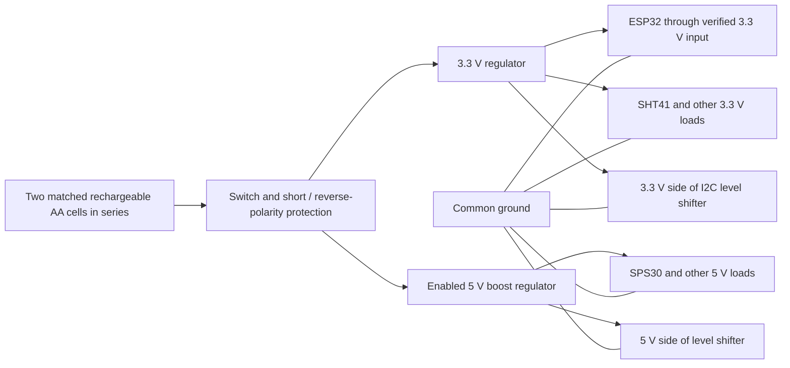

# System architecture

## Overview

Use three layers: small devices near sensors and controls, a local server for coordination and history, and household interfaces for people. They communicate over the home network where practical.

| Layer | Main responsibility | Candidate approach |
| --- | --- | --- |
| Room and outdoor devices | Read sensors and handle simple local inputs or outputs | ESP-based development boards; exact model chosen per device |
| Home server | Collect device states, run automations, keep dashboards and history | Proxmox VE on the old PC, with Home Assistant OS in a virtual machine |
| User interfaces | Show status and provide household controls | Browser-based dashboards on a front-door panel, kitchen screen, or phone |

The server is a coordinator, not a reason to put every feature into one physical board. A failed screen should not stop temperature sensing. A failed room sensor should not affect the existing alarm.

## First communications choice

The first ESP32/SHT41 device is already reporting to Home Assistant over Wi-Fi. The next power prototype uses two removable rechargeable AA cells and independent regulated rails; the faulty/unused 5 V output on the cheap development boards is not part of the supply design.

## Two-AA power architecture

The selected cells are HiQuick AA NiMH, marked 1.2 V and 2800 mAh. Use two cells from the same matched set in series: about 2.4 V nominal, 2800 mAh pack capacity, and 6.72 Wh nominal energy from the label. Treat the printed capacity as an estimate until runtime is measured. A pack voltage this low cannot feed an ESP32 3.3 V supply directly, so regulate it before it reaches any load.

| Requirement | Power path |
| --- | --- |
| 1. Power the ESP32 | Battery pack -> regulated 3.3 V rail -> board input verified for the exact ESP32 board. The regulator must tolerate Wi-Fi current bursts; Espressif recommends a 3.3 V supply capable of at least 500 mA for an ESP32-S3 module. |
| 2. Power 5 V items | Battery pack -> separate 5 V boost regulator -> 5 V device. The SPS30 needs 4.5-5.5 V and draws about 55 mA while measuring, with an 80 mA fan-start peak. Enable/switch this rail so the sensor can be off when not sampling. |
| 3. Power 3.3 V items | Connect each 3.3 V load directly to the regulated 3.3 V distribution rail, in parallel with the ESP32 supply. Do not route sensor current through an ESP32 GPIO or assume the development board's 3.3 V output can supply the other devices. |

Keep the 3.3 V and 5 V regulators' grounds common. Do not feed the bad board 5 V pin, and do not connect a 3.3 V regulator to a board pin until that exact board's input scheme is known. Do not connect its USB supply and external 3.3 V rail together unless the board documentation explicitly permits it. Never place 5 V on ESP32 GPIO or the SHT41 supply.

If the SPS30 5 V rail is switched, also prevent its I2C wiring/level shifter from powering it through signal pins while its supply is off. Bring the bus to a safe state before disabling the sensor rail; confirm the chosen level-shifter arrangement supports this.

Use the cells as a removable pack and charge them in a charger designed for their chemistry. Do not add a lithium-ion charger or charge the AA cells inside the prototype. Use a matched pair with the same chemistry, model, age, and charge state; include a low-battery limit so one cell in the series pair is not driven into deep discharge.

Battery runtime is a measured output of the complete build. Record current and power in Wi-Fi active, sleep, and SPS30 measurement modes, and elapsed runtime down to a conservative low-battery limit. The SPS30 alone uses about 0.275 W in measurement mode (5 V x 55 mA), so continuous measurement would consume the label's 6.72 Wh nominal pack energy in about 24 hours even before converter losses or ESP32 use. Deep sleep and SPS30 duty cycling can extend runtime, at the cost of update frequency and sensor warm-up time.

Before deploying many Wi-Fi devices, check coverage in all rooms and consider how the router handles a larger number of clients. A separate Zigbee, Thread, or other low-power network can be evaluated later if it solves a measured problem and the chosen software supports the required devices.

Radio hardware alone does not guarantee compatibility. In particular, an ESP32-C6 contains an IEEE 802.15.4 radio, but the firmware, network coordinator, and Home Assistant integration still need to be selected and verified as a complete system.

## Optional wired low-voltage power

Reusing existing alarm cable could provide power to selected room nodes, with a central low-voltage supply and local regulation at each node. Treat this as a possibility to survey, not a known capability: first identify the alarm panel and establish each cable's route, topology, conductor count and gauge, condition, and existing connections. Do not connect a new supply to unidentified alarm wiring or assume the old panel's power supply is suitable.

If the wiring is suitable, design the supply voltage and branch protection from the cable lengths and measured loads. A higher distribution voltage with a regulated 5 V converter at each node may reduce voltage drop compared with sending 3.3 V over long thin cable. Confirm voltage at the node under peak load before deployment. The ESP32-S3 chip itself needs 3.3 V; a development board may accept 5 V on its designated input, depending on the exact board. Never put 5 V on sensor or GPIO pins. Do not power a board from USB and its external power input at the same time unless that exact board explicitly supports it.

Wired power does not itself charge a battery. A battery requires a charger matched to its chemistry and cell count, with appropriate protection and power-path behavior. A removable rechargeable battery can instead be charged in a compatible external charger. Keep any 230 V mains supply installation inside a proper enclosure and have fixed wiring or uncertain alarm-panel wiring handled by a qualified professional.

## Device groups

### Room sensor node

A basic room node may report temperature, humidity, and motion or presence. It should be useful without a screen or motor. Use a ventilated sensor opening, and keep temperature/humidity sensors away from warm electronics and direct sunlight.

### Indoor air-quality node

PM2.5 and PM10 monitoring may use a particle sensor such as an SDS011 or a compatible alternative. These sensors need an air path and may have a fan and meaningful power draw. Treat this as a separate, usually powered device until measurements prove a battery design is practical.

If carbon-dioxide measurement is desired, choose a CO2 sensor specifically. A VOC reading is a different measurement and should not be presented as CO2.

### Control node

A separate control node may listen for or send commands to a known remote-controlled device. First identify whether the remote uses infrared, RF, Bluetooth, Wi-Fi, or another method. A receiver can help inspect supported RF or infrared signals, but it does not ensure that the ESP can safely or reliably control the appliance.

### Panels and cameras

Treat the front-door panel, kitchen display, and cameras as their own devices. Their screen, storage, mounting, power, and privacy needs differ from those of room sensors. Do not make a small room sensor board responsible for camera recording or a large display.

### Outdoor station

Plan a dedicated weather station for outdoor temperature and humidity, wind speed and direction, and possibly rainfall. Use an enclosure and sensor placement that can handle outdoor exposure without trapping heat or blocking airflow. Wind and rain sensors need suitable mounting and maintenance. Keep this station distinct from greenhouse or shed nodes, which can measure conditions specific to those spaces and need their own power and enclosure design.

### Server

The old PC now runs Proxmox VE as its bare-metal host, with Home Assistant OS in a virtual machine. Proxmox is at `192.168.2.50:8006`; the Home Assistant VM is on the home network at `192.168.2.202`. The VM uses a bridged VirtIO network interface, so Home Assistant can communicate with the ESPHome prototype on the LAN.

The recorded hardware is an AMD Ryzen 7 3700X, 32 GB DDR4, GTX 1080, and hybrid AIO cooler. About 460 GB of internal storage is reported; earlier setup notes describe a 450 GB M.2 drive. Reconcile the exact capacity and free space, and check drive health, motherboard model, host idle power, and router DHCP reservations. Proxmox and the Home Assistant VM are installed and running. See [the server setup record](09-server-setup.md) for VM settings and installation notes.

Camera recording may need separate storage and video-processing capacity. The current M.2 is the Proxmox and VM system drive; evaluate additional storage before selecting cameras or promising a particular number of days of recordings.

## Board selection notes

- **ESP32-S3:** a general-purpose option with Wi-Fi and Bluetooth LE, and useful peripherals for projects involving displays or cameras.
- **ESP32-C6:** combines Wi-Fi, Bluetooth LE, and 802.15.4 radio hardware. Confirm software and coordinator support before choosing it for a Thread or Zigbee design.
- **Other devices:** a dedicated display computer, certified camera, or purpose-built radio coordinator may be a better fit than an ESP board for that job.

Do not select one ESP board for every device yet. Choose after the first prototype's sensors, required pins, enclosure, radio, software support, and measured power needs are known.

## Reliability and control

- Keep physical controls on devices where practical.
- Make remote-control actions report their current status only when the device can actually confirm it. Do not assume a sent RF command means the appliance changed state.
- Define what each automation does when the network, server, or sensor is unavailable.
- Keep a manual path for any future window, curtain, light, fan, or doorbell control.
- Keep essential alarm functions independent of Home Assistant and the internet.
